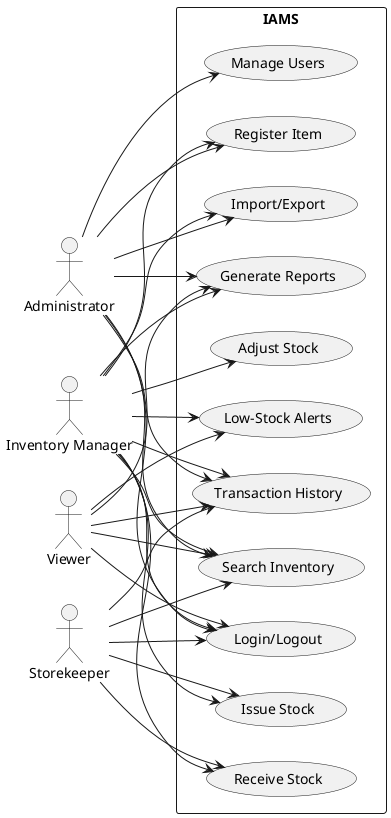
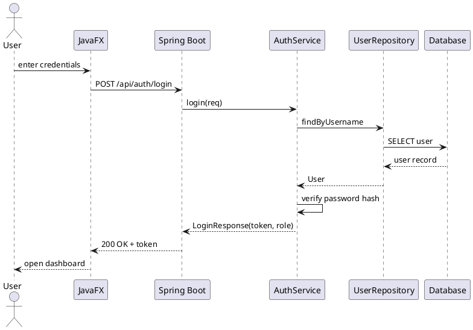
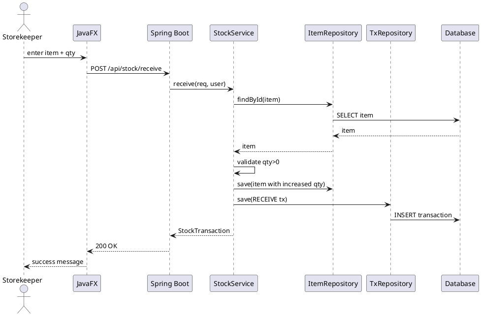
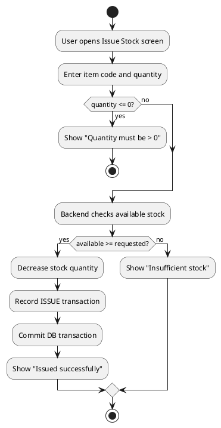
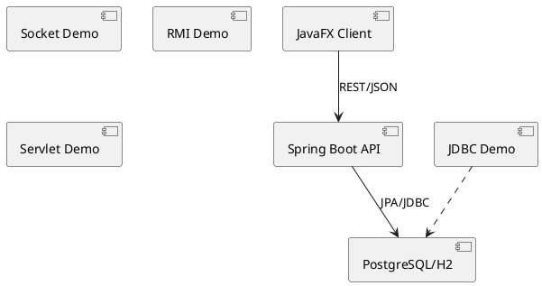

# UML Diagrams - Inventory and Asset Management System (IAMS)

This document collects the UML diagrams for the project (PlantUML source).

## 1. Use Case Diagram


## 2. Class Diagram
```plantuml
@startuml
class User { -id:Long -username:String -passwordHash:String -role:Role }
class Role { -id:Long -name:String }
class Item { -id:Long -itemCode:String -itemName:String -quantity:int -minimumStock:int }
class Category { -id:Long -name:String }
class Location { -id:Long -name:String }
class StockTransaction { -id:Long -type:TransactionType -quantity:int }
enum TransactionType { RECEIVE ISSUE ADJUSTMENT }
Role "1" -- "0..*" User
Category "1" -- "0..*" Item
Location "1" -- "0..*" Item
Item "1" -- "0..*" StockTransaction
User "1" -- "0..*" StockTransaction
@enduml
```

## 3. Sequence Diagram - Login


## 4. Sequence Diagram - Receive Stock


## 5. Activity Diagram - Issue Stock


## 6. Database ER Diagram (summary)
- roles 1..* users
- categories 1..* items
- locations 1..* items
- suppliers 0..1 stock_transactions (source for receives)
- items 1..* stock_transactions
- users 1..* stock_transactions (performed_by)
- users 0..* audit_logs

## 7. Component Diagram

